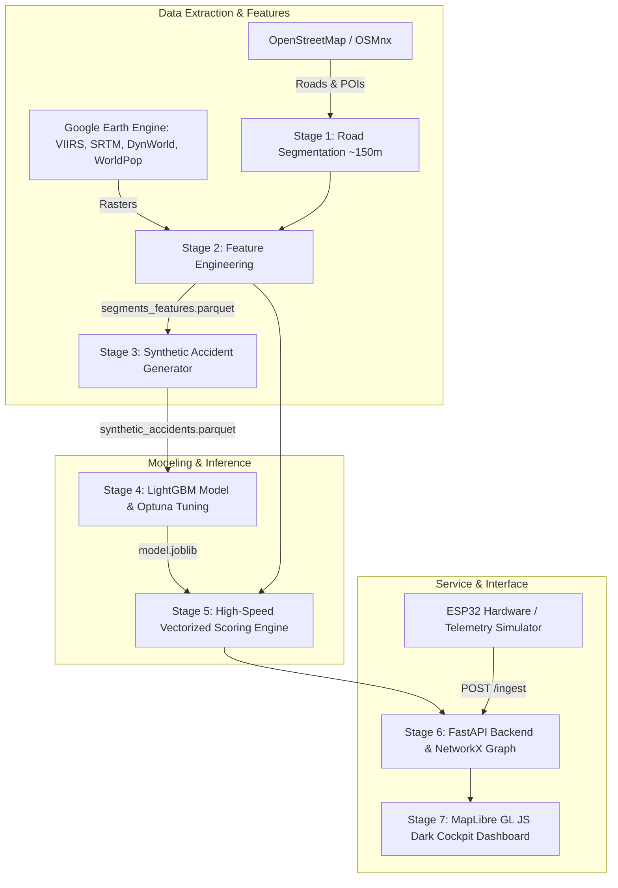

# KDF Navigation — RoadWatch Nagpur

> **A Safety-First Vehicle Navigation Dashboard & Accident Risk Prediction Platform**  
> *Base City: Nagpur, Maharashtra, India*

[](https://www.python.org/)
[](https://fastapi.tiangolo.com/)
[](https://maplibre.org/)
[](https://lightgbm.readthedocs.io/)
[](https://github.com/Therock1037X/Kasukabe-Defence-Force-)

---

## 1. Product Overview

Traditional satellite navigation applications (such as Google Maps or Waze) route vehicles almost exclusively for the **shortest travel time**, frequently routing drivers through hazardous intersections, high-speed arterial bottlenecks, or poorly lit corridors.

**KDF Navigation** changes the paradigm by computing real-time, multi-factor **accident-risk probabilities** for every road segment. It recommends the **Safest Route** alongside the **Fastest Route**, explicitly showing drivers the trade-off in minutes and risk (e.g., *"avoids 1.2 km of high-risk road, adds 4 minutes"*).

### Key Capabilities
- **Dark Cockpit Infotainment Dashboard**: Responsive car-dashboard UI built with MapLibre GL JS, featuring risk-colored road segments (🟢 Green, 🟡 Yellow, 🟠 Orange, 🔴 Red) for current or simulated environmental conditions.
- **Dual-Route Optimization**: Side-by-side Fastest vs. Safest route selection with an interactive **Safety vs. Speed ($\lambda$) Tradeoff Slider**.
- **Drive Simulation & Proximity HUD Warning**: Real-time vehicle simulation along selected routes with forward collision/risk hazard detection within 300 meters, complete with an **on-screen HUD alert** and an **audio warning chime** (Web Audio API).
- **Physical IoT Telemetry Ingestion**: ESP32 microcontroller firmware interfacing NEO-6M GPS, MPU6050 accelerometer ($>0.4g$ harsh deceleration and $>3g$ collision impact detection), rain sensor, and LDR light sensor.
- **Feature Explainability (SHAP)**: Plain-language explanations for why a road is high risk (e.g., *"unlit dark corridor + high speed + heavy rain"*).

---

> [!IMPORTANT]
> ### ⚠️ Synthetic Data & Prototype Disclosure
> **Synthetic data. Prototype only.**  
> While the road network, topography (SRTM), satellite nighttime lighting (VIIRS), and population densities (WorldPop) are extracted from authentic OpenStreetMap and Google Earth Engine layers for Nagpur, the accident records are simulated using a calibrated Poisson process adhering to Indian meteorological dynamics and Nagpur accident hotspot corridors.  
> *See [Section 9](#9-migrating-to-real-morth--police-accident-data) for instructions on substituting real MoRTH or Nagpur Traffic Police FIR datasets.*

---

## 2. Technology Stack

| Layer | Technology | Rationale |
| :--- | :--- | :--- |
| **Frontend** | HTML5, Vanilla JavaScript, CSS3 | Zero build step, minimal friction, lightweight embedded performance. |
| **Map Engine** | MapLibre GL JS | Open-source, GPU-accelerated WebGL vector renderer, zero API key constraints. |
| **Base Map Tiles** | CartoDB Dark Matter / OpenStreetMap | High-contrast dark cockpit theme avoiding Google Maps billing limits. |
| **Backend** | FastAPI (Python) | High throughput asynchronous REST API with automatic interactive OpenAPI docs at `/docs`. |
| **Machine Learning** | LightGBM, Optuna, Scikit-Learn, SHAP | Gradient boosted multiclass classification, hyperparameter tuning, isotonic probability calibration, and feature explainability. |
| **Routing Graph** | NetworkX & OSMnx | Directed road network graph with risk-weighted Dijkstra edge cost: $C = \text{travel\_time} + \lambda \times (\text{risk\_index} \times 100) \times (\text{length} / 100)$. |
| **Geospatial Processing** | GeoPandas, Shapely, PyArrow | Coordinate projections (WGS84 `EPSG:4326` & UTM 44N `EPSG:32644`), spatial buffers, and KDTree spatial snapping. |
| **Storage** | Parquet & GeoParquet, SQLite | Columnar, ultra-fast disk storage for road segments and features; lightweight embedded SQLite for live ESP32 sensor telemetry logs (`sensor_logs.db`). |
| **Hardware** | ESP32, NEO-6M GPS, MPU6050, Rain/LDR | Edge vehicle sensing dispatching JSON payloads over HTTP POST to `/ingest`. |

---

## 3. System Architecture



---

## 4. Directory Structure

```text
/
├── app/
│   ├── __init__.py
│   ├── main.py                     # FastAPI REST API & NetworkX routing graph
│   └── static/                     # Dark cockpit frontend application
│       ├── app.js                  # MapLibre GL, Web Audio chime, drive simulator
│       ├── index.html              # Dashboard layout & HUD banner
│       └── style.css               # Premium automotive HUD styling
├── config.py                       # Global bounding boxes, CRS, seed 42
├── data/
│   ├── segments.parquet            # Stage 1: Partitioned road segments
│   ├── segments_features.parquet   # Stage 2: POI buffers + Earth Engine rasters
│   └── synthetic_accidents.parquet # Stage 3: Simulated accident records
├── esp32/
│   ├── config.example.h            # Wi-Fi & server configuration template
│   ├── sketch.ino                  # Production Arduino firmware
│   └── README.md                   # Hardware pinout & wiring documentation
├── models/
│   ├── feature_list.json           # Categorical & numerical feature ordering
│   └── model.joblib                # Calibrated LightGBM multiclass model
├── outputs/
│   ├── ablation.md                 # Nighttime lighting ablation report
│   ├── model_metrics.json          # F1, Recall, PR-AUC, Confusion Matrix
│   ├── sensor_logs.db              # SQLite log of ESP32 sensor telemetry
│   └── shap_summary.png            # SHAP feature importance plot
├── scripts/
│   └── simulate_esp32.py           # Software vehicle telemetry simulator
├── src/
│   ├── __init__.py
│   ├── gee_init.py                 # Google Earth Engine initialization helper
│   ├── generate_accidents.py       # Stage 3: Poisson accident generator
│   ├── prepare_features.py         # Stage 2: POI joins & GEE extraction
│   ├── prepare_roads.py            # Stage 1: Road segmentation (~150m)
│   ├── score.py                    # Stage 5: Sub-second vectorized scoring engine
│   └── train.py                    # Stage 4: LightGBM training & calibration
├── tests/
│   ├── __init__.py
│   └── test_pipeline.py            # Automated test suite (9 test cases)
├── .env.example                    # Environment variables template
├── .gitignore                      # Strict ignore rules for models and data
└── README.md                       # Complete documentation
```

---

## 5. Quickstart & Installation

### Prerequisites
- Python 3.10+ (tested on Python 3.14 x64)
- Google Earth Engine Cloud Project (for Stage 2 raster extraction only — precomputed features are already included)

### 1. Clone & Set Up Environment
```bash
git clone https://github.com/Therock1037X/Kasukabe-Defence-Force-.git
cd Kasukabe-Defence-Force-

# Create virtual environment (optional)
python -m venv .venv
source .venv/bin/activate  # On Windows: .venv\Scripts\activate

# Install required dependencies
python -m pip install -r requirements.txt
python -m pip install pytest httpx
```

### 2. Configure Environment Variables
Copy `.env.example` to `.env`:
```bash
cp .env.example .env
```
*(Default: `EE_PROJECT=kdf-navigation`)*

---

## 6. Execution Order & Pipeline Reproduction

If you wish to re-run the entire pipeline from raw OpenStreetMap data:

```bash
# Stage 1: Segment road network into ~150m lengths with curvature & junctions
python src/prepare_roads.py

# Stage 2: Merge POIs & extract Earth Engine layers (SRTM, VIIRS, Dynamic World, WorldPop)
python src/prepare_features.py

# Stage 3: Generate calibrated synthetic accidents adhering to Nagpur weather dynamics
python src/generate_accidents.py

# Stage 4: Train LightGBM model with Optuna tuning and isotonic calibration
python src/train.py

# Stage 5: Benchmark vectorized scoring engine (verifies < 3.0s cold latency)
python src/score.py

# Stage 9: Run automated test suite
python -m pytest tests/test_pipeline.py -v
```

---

## 7. Running the Application

### 1. Launch FastAPI Backend
```bash
python -m uvicorn app.main:app --host 127.0.0.1 --port 8000 --reload
```
- Open **http://127.0.0.1:8000/** in your browser to view the **Car-Dashboard Interface**.
- Interactive OpenAPI documentation is accessible at **http://127.0.0.1:8000/docs**.

### 2. Run the ESP32 Telemetry Simulator (Optional)
To simulate a driving vehicle streaming real-time GPS, rain, and light telemetry along Nagpur roads without physical hardware:
```bash
python scripts/simulate_esp32.py --host 127.0.0.1 --port 8000 --scenario rainy_commute
```
*Toggle "ESP32 Live Telemetry" in the dashboard header to watch the vehicle marker drive along the map in real time!*

---

## 8. API Endpoint Reference

### `GET /health`
Returns service readiness, segment count, and road graph node/edge counts.
```bash
curl -X GET "http://127.0.0.1:8000/health"
```

### `GET /risk`
Returns GeoJSON FeatureCollection of all road segments with color-coded risk strips.
- Parameters: `hour` (0-23), `weather` (`clear` | `rain` | `fog` | `storm`), `month` (1-12), `day_type` (`weekday` | `weekend`), `bbox` (optional `min_lon,min_lat,max_lon,max_lat`).
```bash
curl -X GET "http://127.0.0.1:8000/risk?hour=19&weather=rain"
```

### `GET /segment/{segment_id}`
Returns granular accident probabilities ($P_\text{minor}, P_\text{serious}, P_\text{fatal}$), physical attributes, environmental features, and top 3 plain-language risk drivers.
```bash
curl -X GET "http://127.0.0.1:8000/segment/101?hour=21&weather=storm"
```

### `GET /route`
Calculates Fastest vs. Safest routes side-by-side using risk-weighted Dijkstra routing.
- Parameters: `from` (`lat,lon`), `to` (`lat,lon`), `lambda` (0.0 to 10.0, default 1.5).
```bash
curl -X GET "http://127.0.0.1:8000/route?from=21.144,79.066&to=21.105,79.075&lambda=1.5&weather=rain&hour=19"
```

### `POST /ingest`
Accepts real-time telemetry from ESP32 vehicle node, infers weather/light conditions, snaps to nearest road segment, and logs harsh braking events to SQLite.
```bash
curl -X POST "http://127.0.0.1:8000/ingest" \
     -H "Content-Type: application/json" \
     -d '{"lat": 21.1442, "lon": 79.0664, "speed": 45.0, "rain_sensor": 720.0, "ldr": 180.0, "harsh_brake": 1}'
```

### `GET /alert`
Proximity hazard query checking if the vehicle is within 300 meters of an Orange or Red high-risk road segment.
```bash
curl -X GET "http://127.0.0.1:8000/alert?lat=21.144&lon=79.066&hour=22&weather=storm"
```

---

## 9. Migrating to Real MoRTH / Police Accident Data

To replace the synthetic generator with real crash records (e.g., from the Ministry of Road Transport and Highways or Nagpur Police FIR records):

1. **Format Input File**: Save your historical crash records to `data/accidents_real.csv` with the following columns:
   - `latitude`, `longitude` (WGS84)
   - `timestamp` (ISO datetime)
   - `severity` (`minor`, `serious`, or `fatal`)
   - `weather` (`clear`, `rain`, `fog`, `storm`)
   - `light` (`daylight`, `dark`)
2. **Spatial Snapping**:
   Use `scipy.spatial.KDTree` to snap each crash coordinate to the nearest `segment_id` in `data/segments.parquet` within a maximum distance threshold of 50 meters.
3. **Re-train Model**:
   Update `ACCIDENTS_PARQUET` in `src/train.py` to point to your snapped dataset and run:
   ```bash
   python src/train.py
   ```
4. All downstream components (scoring engine, FastAPI routing, car-dashboard UI) will automatically utilize the real-world trained model weights.

---

## 10. Verification & Test Suite

The repository includes a comprehensive automated test suite verifying data integrity, statistical class distributions, inference latencies, and API contracts.

Run tests:
```bash
python -m pytest tests/test_pipeline.py -v
```

```text
tests/test_pipeline.py::test_segments_data_integrity PASSED              [ 11%]
tests/test_pipeline.py::test_synthetic_accident_distribution PASSED      [ 22%]
tests/test_pipeline.py::test_scoring_engine_performance_and_validity PASSED [ 33%]
tests/test_pipeline.py::test_api_health PASSED                           [ 44%]
tests/test_pipeline.py::test_api_risk_geojson PASSED                     [ 55%]
tests/test_pipeline.py::test_api_segment_details PASSED                  [ 66%]
tests/test_pipeline.py::test_api_route_optimization PASSED               [ 77%]
tests/test_pipeline.py::test_api_telemetry_ingest_and_live PASSED        [ 88%]
tests/test_pipeline.py::test_api_proximity_alert PASSED                  [100%]

======================= 9 passed in 6.69s =======================
```

---

## 11. License & Disclaimers

Developed by the **Kasukabe Defence Force (KDF)**.  
For educational, research, and prototype demonstration purposes only.  
*Synthetic data disclaimer: Segment risk metrics reflect calibrated statistical modeling and do not constitute legal road safety advice.*
